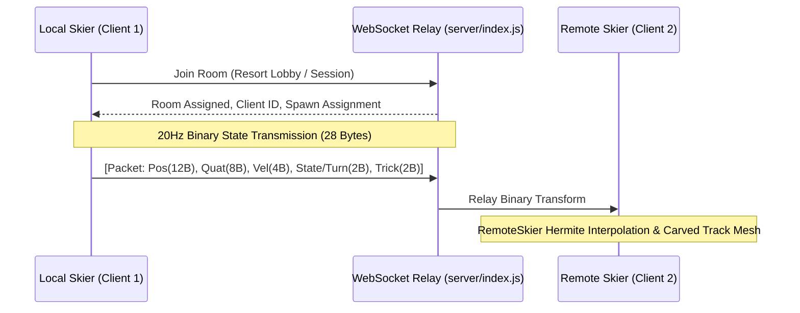

# Alpine Freeride: Master Refactoring, Modularization & Multiplayer Blueprint

> **Architecture Status:** Production Refactoring & Realtime Multiplayer Implementation  
> **Target Subsystems:** WebGL / Three.js, Rapier3D WASM, Procedural Terrain, Alpine Physics, WebSocket Multiplayer  

---

## 1. Technical Premise & Objectives

This document establishes the end-to-end plan to transform the codebase from a hybrid prototype (carrying leftover assets from a legacy off-road car engine) into a clean, modular, production-grade alpine skiing simulation with realtime multiplayer synchronization.

### Primary Directives
1. **Dead Code Purge:** Completely eliminate 26 unreferenced legacy files in `src/world/` and the obsolete `slow_roads_extracted_core/` asset directory.
2. **Modular Architecture:** Decompose the 1,688-line `SkierCharacter.ts`, 1,137-line `boarder.ts`, and monolithic `main.ts` into single-responsibility domain modules.
3. **Multiplayer Skier Architecture:** Re-architect `server/index.js` and build client network synchronizers for binary-packed skier state, remote skier interpolation, remote carved snow tracks, and trick broadcasts.

---

## 2. Phase 1: Dead Code & Legacy Asset Removal (Zero Regression)

### 2.1 Files Purged from `src/world/`
All 26 files have zero callers and zero runtime dependencies:
* `src/world/slowroads/` (14 files: `alea.js`, `baseTileCache.js`, `biomePresets.js`, `catmullRomCurve3.js`, `hillsMidlineGenerator.js`, `index.js`, `layeredHeightmap.js`, `midlineSpatialIndex.js`, `perlin.js`, `roadMesh.js`, `roadSurveyor.js`, `roadTerrainBlender.js`, `terrainMesh.js`, `vector3.js`)
* `src/world/managers/` (`RoadMeshManager.ts`, `TerrainChunk.ts`, `TerrainManager.ts`)
* `src/world/generators/` (`terrainWorker.ts`, `structurePlacer.ts`, `foliageSpawner.ts`)
* `src/world/math/` (`slowRoadsCore.ts`, `splineCarver.ts`, `noiseLayers.ts` — *retained: `prng.ts`*)
* `src/world/config/terrainConfig.ts`
* `src/world/biomes/biomeEvaluator.ts`
* `src/world/Phase1TestSlope.ts`

### 2.2 Legacy Repositories & Spikes Purged
* `slow_roads_extracted_core/` (52MB of legacy bike/car 3D models and surveyor demos).
* `src/player/TrickEngine.ts` (Dead proxy layer superseded by authentic GMA `TrickScoringSystem`).

### 2.3 Verification Gate
* Execute `npm run build` (`tsc && vite build`) to prove zero module resolution errors.

---

## 3. Phase 2: Modular Subsystem Decomposition

```text
src/
├── main.ts                          # Lightweight application bootstrap (<30 lines)
├── core/
│   ├── Game.ts                      # Game loop coordinator & 60Hz physics accumulator
│   ├── Renderer.ts                  # Three.js scene, lighting, ACES tonemapping & fog
│   ├── PhysicsEngine.ts             # Rapier3D WASM initialization & step driver
│   └── InputController.ts           # Unified keyboard & gamepad polling
├── player/
│   ├── SkierController.ts           # Kinematic/dynamic actor (replaces monolithic boarder.ts)
│   └── character/
│       ├── SkierPalette.ts          # Outfit color palettes (coral, ochre, glacier, pine)
│       ├── SkierGeometry.ts         # Procedural lofted jacket, collar, skis & boots
│       ├── SkierRig.ts              # Hierarchical bone rig assembly & joint anchoring
│       └── SkierAnimator.ts         # Procedural IK, poling gait, carving lean & ragdoll blend
├── mechanics/                       # Pure Grand Mountain Adventure Physics Engine
│   ├── GmaPlayerPhysics.ts          # 333Hz carving, fall-line gravity & momentum
│   ├── ControlsProcessor.ts         # Nonlinear steering curves & deadzones
│   ├── TrickScoring.ts              # Aerial recognition, combo multipliers & stomps
│   ├── VerletRagdoll.ts             # 50Hz particle crash & tumble solver
│   ├── PiecewiseCurve.ts            # Speed-dependent turn & drift splines
│   └── GmaConfig.ts                 # GMA constants, thresholds & enums
├── world/
│   ├── AlpineMassif.ts              # 6x6 chunked mesh generator & Rapier colliders
│   ├── AlpineHeightfield.ts         # 5-layer procedural slope math
│   ├── shaders/
│   │   ├── SnowMaterial.ts          # Micro-sparkle PBR snow shader
│   │   ├── SnowTrailMaterial.ts     # Normal-perturbed carved rut shader
│   │   └── DetailTexture.ts         # Procedural noise normal maps
│   ├── trails/
│   │   └── CarvedSnowTrail.ts       # Dynamic ski track ribbon mesh painter
│   ├── environment/
│   │   ├── SkyDome.ts               # Atmospheric gradient sky dome
│   │   ├── DayNightCycle.ts         # Solar azimuth/elevation & color grading
│   │   └── AirborneSparkles.ts      # Sun glint particle system
│   └── math/
│       └── prng.ts                  # Seeded cyrb128 + mulberry32 PRNG
├── camera/
│   ├── CameraDirector.ts            # Dynamic chase cam & GMA isometric tilt-shift
│   ├── CameraTunerOverlay.ts        # Runtime interactive parameter tuning GUI
│   └── CameraConfig.ts              # Camera offsets, FOV widening & smoothing
├── audio/
│   └── SnowAudio.ts                 # Web Audio procedural wind, carve & thump synth
└── ui/
    ├── HudOverlay.ts                # Speedometer, altitude, carve charge & trick HUD
    └── LightingControls.ts          # Day / Golden Hour / Night mode toggle widget
```

### 2.1 Audio Decoupling
* Extract `SnowAudio` out of `src/boarder.ts` into `src/audio/SnowAudio.ts`.
* Expose clean lifecycle: `init()`, `update(speed, vLateral, isGrounded, isDrifting, grip)`, `playLandThump()`, `playPolePlant()`.

### 2.2 Character Monolith Modularization
* Split `src/player/SkierCharacter.ts` (1,688 lines) into:
  1. `src/player/character/SkierPalette.ts` (~60 lines): Palette structures and preset definitions.
  2. `src/player/character/SkierGeometry.ts` (~250 lines): Procedural buffer geometries (`createLoftedGeometry`, `createFlaredCollarGeometry`, `createAlpineSki`).
  3. `src/player/character/SkierRig.ts` (~300 lines): Object hierarchy, materials, ski attachments, pole pivots.
  4. `src/player/character/SkierAnimator.ts` (~700 lines): Procedural IK, poling stride, carving body roll, aero tuck, air spin/flip rotations, ragdoll pose transitions.

### 2.3 Player Controller Modernization
* Rename `src/boarder.ts` to `src/player/SkierController.ts`.
* Eliminate dead `SnowTrailRibbon` class.
* Directly expose `GmaPlayerPhysics.trickScoring` to UI, removing the redundant `TrickEngine` proxy layer.

### 2.4 Application Core & UI Extraction
* Move game loop, physics stepping, and hotkeys from `main.ts` into `src/core/Game.ts`.
* Move HUD generation, speedometer, and trick banners into `src/ui/HudOverlay.ts`.
* Reduce `src/main.ts` to an entry script under 30 lines.

---

## 4. Phase 3: Multiplayer Server & Skier Synchronization Engine

### 4.1 Networking Premise & Architecture
Transform the legacy 4x4 car relay server (`server/index.js`) into a high-performance, low-latency WebSocket synchronization system for skiers across the 2.4 km × 2.4 km Alvdalen mountain.



### 4.2 Binary Packet Schema (28 Bytes / Tick @ 20Hz)
To achieve zero-allocation, bandwidth-efficient streaming for mobile and web:

| Field | Offset | Type | Description |
| :--- | :--- | :--- | :--- |
| `clientId` | 0 | `uint8` | Unique player slot / ID (1–64) |
| `posX` | 1 | `float32` | World X coordinate (m) |
| `posY` | 5 | `float32` | World Y elevation (m) |
| `posZ` | 9 | `float32` | World Z coordinate (m) |
| `yaw` | 13 | `int16` | Quantized heading ($-\pi$ to $\pi$ $\to$ `[-32768, 32767]`) |
| `pitch` | 15 | `int16` | Quantized terrain pitch |
| `roll` | 17 | `int16` | Quantized carve lean / trick roll |
| `speed` | 19 | `uint16` | Speed in $0.01\text{ m/s}$ (up to $655\text{ m/s}$) |
| `turnType` | 21 | `uint8` | Standard, Sharp, Slide, Overturn |
| `movementState` | 22 | `uint8` | Standing, Gliding, Airborne, Crashing |
| `paletteId` | 23 | `uint8` | Outfit color index (0–3) |
| `trickId` | 24 | `uint8` | Active aerial grab / spin id |
| `flags` | 25 | `uint8` | Bit 0: Grounded, Bit 1: Twintips, Bit 2: Staking, Bit 3: Brake |
| *Reserved* | 26 | `uint16` | Future expansion / ping timestamp |

### 4.3 Server Modernization (`server/index.js`)
* Replace hardcoded 4x4 car slots (`Olive Green`, `Rescue Orange`, etc.) with dynamic skier session management.
* Support multiple room instances (`default-resort`, custom room codes).
* Broadcast join/leave lifecycle events with assigned outfit palettes.
* Broadcast binary transforms to all other peers in the room with `ws._socket.setNoDelay(true)`.

### 4.4 Client Network Subsystem
* `src/network/NetworkManager.ts`: Handles WebSocket connection, reconnection backoff, packet serialization/deserialization.
* `src/network/RemoteSkier.ts`:
  * Manages remote player instances with `SkierRig` and `SkierAnimator`.
  * Employs snapshot interpolation (Hermite position smoothing, SLERP quaternion rotation) across a 100ms jitter buffer.
  * Drives dedicated `CarvedSnowTrail` instances for each remote skier so their ski ruts appear on the snow in real time.
  * Renders remote skier name tags and trick popups.

---

## 5. Phase 4: Production Deployment & Verification

### 5.1 Configuration & Docs Alignment
* Update `package.json`: Rebrand name from `drive-game` to `alpine-freeride-game`.
* Update `render.yaml` & `DEPLOYMENT.md`: Replace `off-road-4x4-coop` branding with `alpine-freeride`.
* Update `PROJECT.md`: Comprehensive technical document reflecting only active alpine skiing and procedural massif systems.

### 5.2 Verification Gates
1. **Compilation Gate:** `npm run build` cleanly succeeds with zero warnings.
2. **Visual Parity Gate:** `node vision/capture.mjs` confirms layout, colors, and animations match reference captures.
3. **Multiplayer Local Gate:** Open two browser tabs on `http://localhost:3001` to verify dual-skier synchronization, carving trails, and trick scoring.
